<div align="center">

# AgriPak Data Analysis Report

**Dynamically generated exploratory audit, cleaning log, leakage check, and feature-engineering report.**


**[1. Overview](#1-dataset-overview--target-balance)** |
**[2. Statistical Audit](#2-data-quality--exploratory-statistical-audit)** |
**[3. Cleaning](#3-data-cleaning-audit)** |
**[4. Leakage Check](#4-leakage-sanity-check)** |
**[5. Feature Engineering](#5-feature-engineering--model-validation)** |
**[6. Exit Codes & Reproducibility](#6-cli-exit-codes--reproducibility)** |
**[Project README](../../README.md)**

</div>

---

This report is dynamically generated from `data/raw` and provides two high-level deliverables:

- Complete exploratory and statistical audit covering distributions, non-parametric tests, correlations, interactions, and independence checks.
- Reproducible cleaning audit, single-feature leakage verification, plot-driven feature engineering, and cross-validated model benchmarks.

| Metric | Value |
| --- | --- |
| Raw input shape | `50,000` rows x `10` cols |
| Cleaned shape | `50,000` rows x `10` cols |
| Memory footprint | `12.59 MB` -> `1.19 MB` |
| Inferred target | `low_yield_risk` (`35.0%` baseline) |
| Generated charts | `15` / `15` |

---

## 1. Dataset Overview & Target Balance

Source input: `data/raw`

- **Dimensions:** `50,000` rows x `10` columns (raw input `50,000` x `10`)
- **Minimum subgroup threshold (`min_n`):** `500`
- **Baseline positive rate:** `35.0%`
- **Target column:** `low_yield_risk` (`binary_flag`)
- **Primary driver:** `rainfall_mm`
- **Secondary driver:** `temperature_c`
- **Primary subgroup:** `weather_condition`

### 1.1 Schema & Column Profiles

| column | kind | role | dtype | nunique | null_count | null_pct |
| --- | --- | --- | --- | --- | --- | --- |
| region | categorical | feature | str | 4 | 0 | 0.00 |
| soil_type | categorical | feature | str | 6 | 0 | 0.00 |
| crop | categorical | feature | str | 6 | 0 | 0.00 |
| rainfall_mm | numeric_continuous | primary_driver | float64 | 38405 | 0 | 0.00 |
| temperature_c | numeric_continuous | secondary_driver | float64 | 2501 | 0 | 0.00 |
| fertilizer_used | binary_flag | feature | int64 | 2 | 0 | 0.00 |
| irrigation_used | binary_flag | feature | int64 | 2 | 0 | 0.00 |
| weather_condition | categorical | primary_subgroup | str | 3 | 0 | 0.00 |
| days_to_harvest | numeric_discrete | feature | int64 | 90 | 0 | 0.00 |
| low_yield_risk | binary_flag | target | int64 | 2 | 0 | 0.00 |

### 1.2 Numeric Summary & Target Distribution

| index | count | mean | std | min | 25% | 50% | 75% | max |
| --- | --- | --- | --- | --- | --- | --- | --- | --- |
| rainfall_mm | 50000.000 | 550.873 | 259.775 | 100.010 | 325.923 | 550.285 | 774.422 | 999.980 |
| temperature_c | 50000.000 | 27.428 | 7.232 | 15.000 | 21.150 | 27.420 | 33.670 | 40.000 |
| days_to_harvest | 50000.000 | 104.606 | 25.891 | 60.000 | 82.000 | 105.000 | 127.000 | 149.000 |

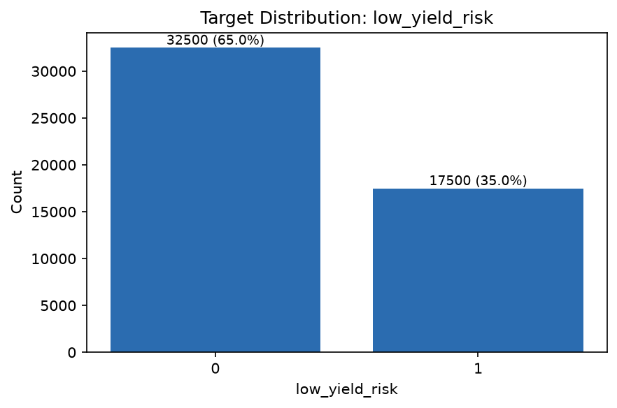

**What the output says:**
- `low_yield_risk` has `35.0%` positive class and `65.0%` negative class across `50,000` rows.
- Raw dataset memory footprint before optimization: `1.19 MB`.

---

## 2. Data Quality & Exploratory Statistical Audit

### 2.1 Nulls, Cardinality, Exact Duplicates & Text Hygiene

| column | dtype | non_null | missing_count | missing_pct | n_unique |
| --- | --- | --- | --- | --- | --- |
| region | category | 50000 | 0 | 0.000 | 4 |
| soil_type | category | 50000 | 0 | 0.000 | 6 |
| crop | category | 50000 | 0 | 0.000 | 6 |
| rainfall_mm | float64 | 50000 | 0 | 0.000 | 38405 |
| temperature_c | float64 | 50000 | 0 | 0.000 | 2501 |
| fertilizer_used | int8 | 50000 | 0 | 0.000 | 2 |
| irrigation_used | int8 | 50000 | 0 | 0.000 | 2 |
| weather_condition | category | 50000 | 0 | 0.000 | 3 |
| days_to_harvest | int16 | 50000 | 0 | 0.000 | 90 |
| low_yield_risk | int8 | 50000 | 0 | 0.000 | 2 |

| column | whitespace_issues | missing_token_hits | case_variants |
| --- | --- | --- | --- |
| region | 0 | 0 | 0 |
| soil_type | 0 | 0 | 0 |
| crop | 0 | 0 | 0 |
| rainfall_mm | 0 | 0 | 0 |
| temperature_c | 0 | 0 | 0 |
| fertilizer_used | 0 | 0 | 0 |
| irrigation_used | 0 | 0 | 0 |
| weather_condition | 0 | 0 | 0 |
| days_to_harvest | 0 | 0 | 0 |
| low_yield_risk | 0 | 0 | 0 |

**What the output says:**
- **Completeness:** `0` missing values across `10` columns and `0` exact duplicate rows.
- **Text hygiene:** `0` leading/trailing whitespace issues, `0` placeholder tokens, and `0` case-variant collisions.

### 2.2 Numeric Distributions & Shape Metrics

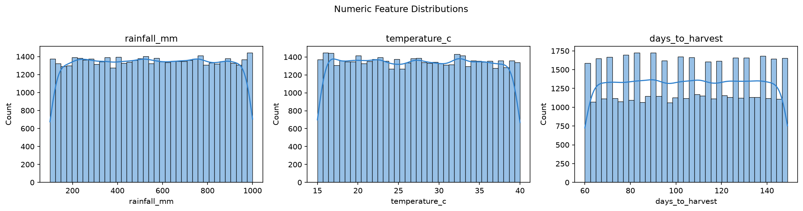

| column | count | mean | std | median | iqr | min | max | skewness | kurtosis | outlier_count_iqr | outlier_pct |
| --- | --- | --- | --- | --- | --- | --- | --- | --- | --- | --- | --- |
| rainfall_mm | 50000 | 550.873 | 259.775 | 550.285 | 448.500 | 100.010 | 999.980 | -0.000 | -1.196 | 0 | 0.000 |
| temperature_c | 50000 | 27.428 | 7.232 | 27.420 | 12.520 | 15.000 | 40.000 | 0.007 | -1.205 | 0 | 0.000 |
| days_to_harvest | 50000 | 104.606 | 25.891 | 105.000 | 45.000 | 60.000 | 149.000 | -0.001 | -1.197 | 0 | 0.000 |

**What the output says:**
- `rainfall_mm` spans `100.01` to `999.98` (median `550.28`, skew `-0.000`, excess kurtosis `-1.196`).
- `temperature_c` spans `15.00` to `40.00` (median `27.42`, skew `0.007`, excess kurtosis `-1.205`).
- `days_to_harvest` spans `60.00` to `149.00` (median `105.00`, skew `-0.001`, excess kurtosis `-1.197`).

### 2.3 Categorical & Binary Feature Distributions

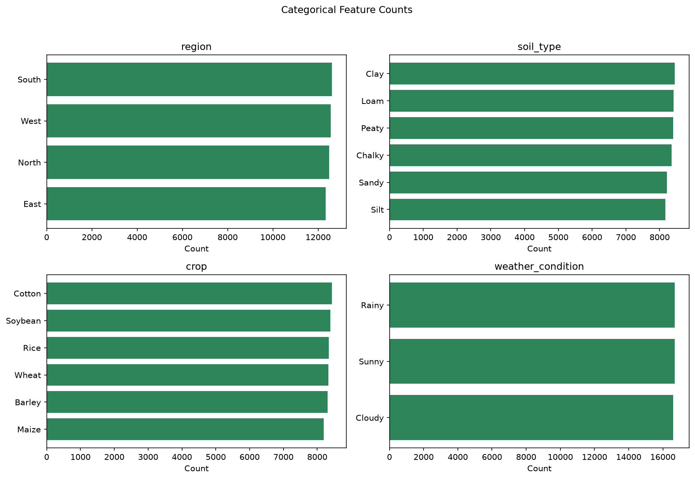

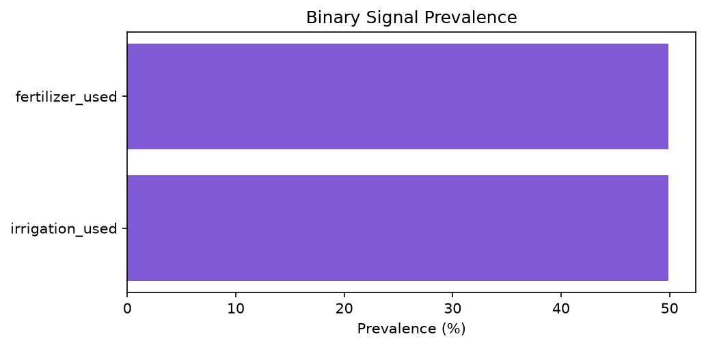

**What the output says:**
- `region` has `4` levels; level shares range from `24.7%` to `25.2%` (largest: `South` at `25.2%`).
- `soil_type` has `6` levels; level shares range from `16.3%` to `16.9%` (largest: `Clay` at `16.9%`).
- `crop` has `6` levels; level shares range from `16.4%` to `16.9%` (largest: `Cotton` at `16.9%`).
- `weather_condition` has `3` levels; level shares range from `33.2%` to `33.4%` (largest: `Rainy` at `33.4%`).
- `fertilizer_used` has `2` levels; level shares range from `49.9%` to `50.1%` (largest: `0` at `50.1%`).
- `irrigation_used` has `2` levels; level shares range from `49.9%` to `50.1%` (largest: `0` at `50.1%`).
- `low_yield_risk` has `2` levels; level shares range from `35.0%` to `65.0%` (largest: `0` at `65.0%`).

### 2.4 Target Rate by Categorical & Binary Features

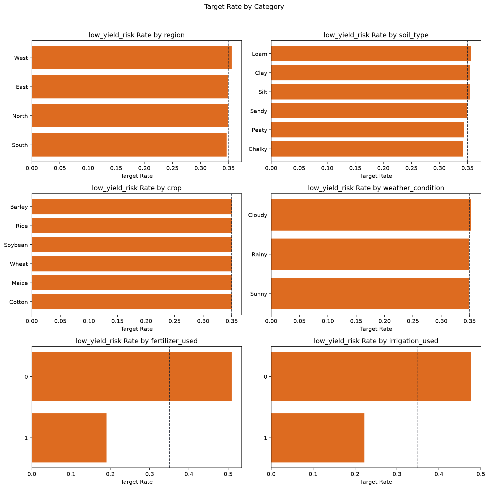

**What the output says:**
- `region` target rate spans `34.6%` (`South`) to `35.6%` (`West`), spread `0.9` pp.
- `soil_type` target rate spans `34.2%` (`Chalky`) to `35.7%` (`Loam`), spread `1.5` pp.
- `crop` target rate spans `35.0%` (`Cotton`) to `35.0%` (`Barley`), spread `0.0` pp.
- `weather_condition` target rate spans `34.9%` (`Sunny`) to `35.3%` (`Cloudy`), spread `0.4` pp.
- `fertilizer_used` target rate spans `19.0%` (`1`) to `50.9%` (`0`), spread `31.9` pp.
- `irrigation_used` target rate spans `22.3%` (`1`) to `47.7%` (`0`), spread `25.4` pp.

### 2.5 Numeric Distributions by Target Class & Mann-Whitney U Tests

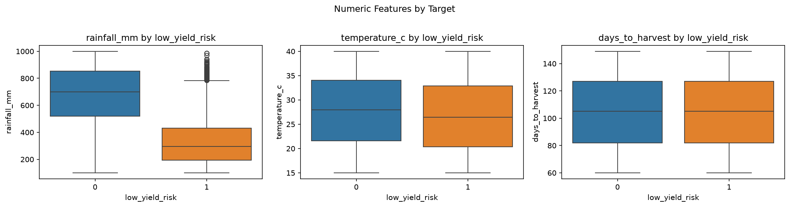

| feature | u_stat | p_value | p_adj_fdr | median_neg | median_pos | rank_biserial |
| --- | --- | --- | --- | --- | --- | --- |
| rainfall_mm | 65286936.0000 | 0.0000 | 0.0000 | 700.6300 | 295.3300 | -0.7704 |
| fertilizer_used | 184748750.0000 | 0.0000 | 0.0000 | 1.0000 | 0.0000 | -0.3503 |
| irrigation_used | 205022500.0000 | 0.0000 | 0.0000 | 1.0000 | 0.0000 | -0.2790 |
| temperature_c | 260794499.5000 | 0.0000 | 0.0000 | 27.9300 | 26.4400 | -0.0829 |
| days_to_harvest | 285286780.0000 | 0.5536 | 0.5536 | 105.0000 | 105.0000 | 0.0032 |

**What the output says:**
- `rainfall_mm`: median `700.63` (class 0) vs `295.33` (class 1), rank-biserial `-0.770`, FDR q-value `0.000e+00`.
- `fertilizer_used`: median `1.00` (class 0) vs `0.00` (class 1), rank-biserial `-0.350`, FDR q-value `0.000e+00`.
- `irrigation_used`: median `1.00` (class 0) vs `0.00` (class 1), rank-biserial `-0.279`, FDR q-value `0.000e+00`.
- `temperature_c`: median `27.93` (class 0) vs `26.44` (class 1), rank-biserial `-0.083`, FDR q-value `7.280e-53`.
- `days_to_harvest`: median `105.00` (class 0) vs `105.00` (class 1), rank-biserial `0.003`, FDR q-value `5.536e-01`.

### 2.6 Spearman Correlation & Decile Target Curves

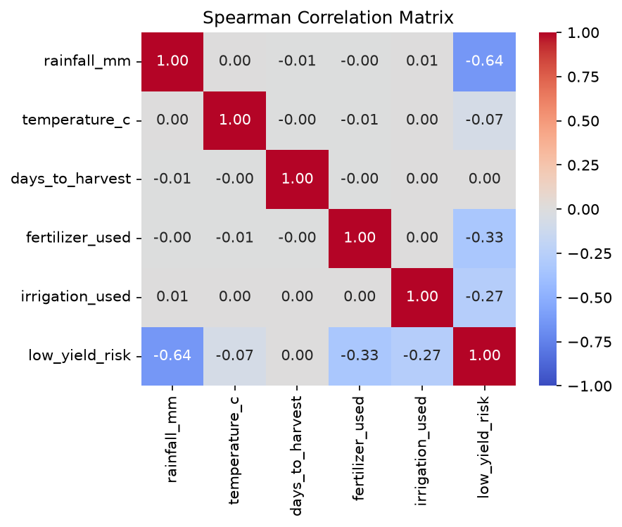

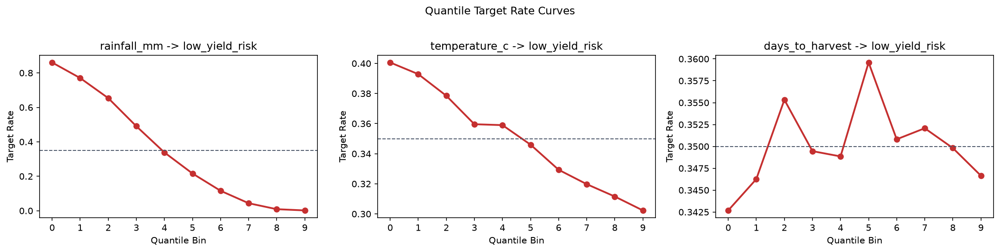

| feature | spearman_r | abs_spearman_r |
| --- | --- | --- |
| rainfall_mm | -0.6365 | 0.6365 |
| fertilizer_used | -0.3342 | 0.3342 |
| irrigation_used | -0.2662 | 0.2662 |
| temperature_c | -0.0685 | 0.0685 |
| days_to_harvest | 0.0026 | 0.0026 |

**What the output says:**
- Strongest monotonic predictor of target is `rainfall_mm` (Spearman `rho = -0.636`).
- `rainfall_mm` decile target rate ranges from `0.2%` to `86.1%`.
- `temperature_c` decile target rate ranges from `30.2%` to `40.1%`.
- `days_to_harvest` decile target rate ranges from `34.3%` to `36.0%`.

### 2.7 Pairwise Interactions & Condition Combinations

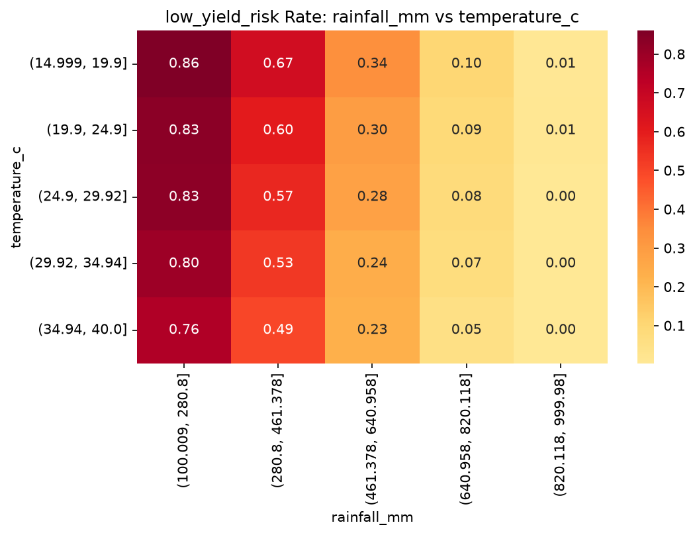

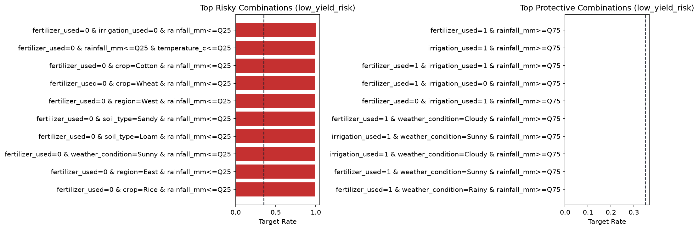

Evaluated `2,389` multi-feature combinations with `n >= 500`.

#### Top Elevated-Risk Combinations

| combination | k | n | target_rate | lift | synergy |
| --- | --- | --- | --- | --- | --- |
| fertilizer_used=0 & irrigation_used=0 & rainfall_mm<=Q25 | 3 | 3166 | 1.000 | 0.650 | -0.077 |
| fertilizer_used=0 & rainfall_mm<=Q25 & temperature_c<=Q25 | 3 | 1597 | 0.996 | 0.646 | 0.000 |
| fertilizer_used=0 & crop=Cotton & rainfall_mm<=Q25 | 3 | 1020 | 0.992 | 0.642 | 0.042 |
| fertilizer_used=0 & crop=Wheat & rainfall_mm<=Q25 | 3 | 1087 | 0.990 | 0.640 | 0.040 |
| fertilizer_used=0 & region=West & rainfall_mm<=Q25 | 3 | 1599 | 0.989 | 0.639 | 0.034 |
| fertilizer_used=0 & soil_type=Sandy & rainfall_mm<=Q25 | 3 | 997 | 0.989 | 0.639 | 0.040 |
| fertilizer_used=0 & soil_type=Loam & rainfall_mm<=Q25 | 3 | 1103 | 0.988 | 0.638 | 0.032 |
| fertilizer_used=0 & weather_condition=Sunny & rainfall_mm<=Q25 | 3 | 2039 | 0.987 | 0.637 | 0.038 |
| fertilizer_used=0 & region=East & rainfall_mm<=Q25 | 3 | 1505 | 0.987 | 0.637 | 0.037 |
| fertilizer_used=0 & crop=Rice & rainfall_mm<=Q25 | 3 | 1033 | 0.986 | 0.636 | 0.036 |

#### Top Protective Combinations

| combination | k | n | target_rate | lift | synergy |
| --- | --- | --- | --- | --- | --- |
| fertilizer_used=1 & rainfall_mm>=Q75 | 2 | 6269 | 0.000 | -0.350 | 0.150 |
| irrigation_used=1 & rainfall_mm>=Q75 | 2 | 6242 | 0.000 | -0.350 | 0.118 |
| fertilizer_used=1 & irrigation_used=1 & rainfall_mm>=Q75 | 3 | 3178 | 0.000 | -0.350 | 0.277 |
| fertilizer_used=1 & irrigation_used=0 & rainfall_mm>=Q75 | 3 | 3091 | 0.000 | -0.350 | 0.023 |
| fertilizer_used=0 & irrigation_used=1 & rainfall_mm>=Q75 | 3 | 3064 | 0.000 | -0.350 | -0.042 |
| fertilizer_used=1 & weather_condition=Cloudy & rainfall_mm>=Q75 | 3 | 2128 | 0.000 | -0.350 | 0.147 |
| irrigation_used=1 & weather_condition=Sunny & rainfall_mm>=Q75 | 3 | 2098 | 0.000 | -0.350 | 0.119 |
| irrigation_used=1 & weather_condition=Cloudy & rainfall_mm>=Q75 | 3 | 2093 | 0.000 | -0.350 | 0.115 |
| fertilizer_used=1 & weather_condition=Sunny & rainfall_mm>=Q75 | 3 | 2085 | 0.000 | -0.350 | 0.151 |
| fertilizer_used=1 & weather_condition=Rainy & rainfall_mm>=Q75 | 3 | 2056 | 0.000 | -0.350 | 0.151 |

#### Strongest Non-Additive Synergies

| combination | k | n | target_rate | lift | synergy |
| --- | --- | --- | --- | --- | --- |
| fertilizer_used=1 & irrigation_used=1 & rainfall_mm>=Q75 | 3 | 3178 | 0.000 | -0.350 | 0.277 |
| fertilizer_used=1 & rainfall_mm>=Q75 & temperature_c>=Q75 | 3 | 1506 | 0.000 | -0.350 | 0.191 |
| irrigation_used=1 & rainfall_mm>=Q75 & temperature_c>=Q75 | 3 | 1529 | 0.000 | -0.350 | 0.159 |
| fertilizer_used=1 & soil_type=Chalky & rainfall_mm>=Q75 | 3 | 1031 | 0.000 | -0.350 | 0.158 |
| fertilizer_used=1 & soil_type=Peaty & rainfall_mm>=Q75 | 3 | 1053 | 0.000 | -0.350 | 0.156 |
| fertilizer_used=1 & region=South & rainfall_mm>=Q75 | 3 | 1604 | 0.000 | -0.350 | 0.154 |
| fertilizer_used=1 & rainfall_mm>=Q75 & days_to_harvest<=Q25 | 3 | 1553 | 0.000 | -0.350 | 0.152 |
| fertilizer_used=1 & soil_type=Sandy & rainfall_mm>=Q75 | 3 | 1076 | 0.000 | -0.350 | 0.151 |
| fertilizer_used=1 & weather_condition=Sunny & rainfall_mm>=Q75 | 3 | 2085 | 0.000 | -0.350 | 0.151 |
| fertilizer_used=1 & region=North & rainfall_mm>=Q75 | 3 | 1564 | 0.000 | -0.350 | 0.151 |

**What the output says:**
- Train/test split replication rate across top combinations: `100.0%`.

### 2.8 Continuous x Binary Interactions & Subgroup Stability

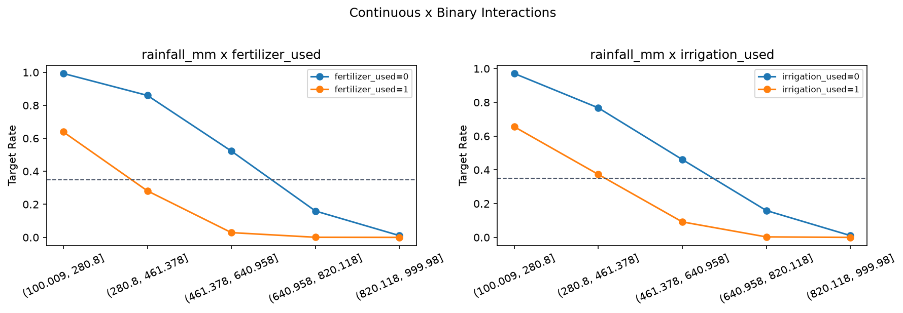

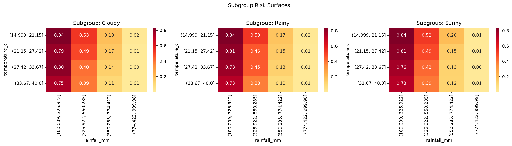

**What the output says:**
- Primary continuous driver `rainfall_mm` paired with secondary driver `temperature_c` across subgroup `weather_condition`.
- Computed subgroup risk surfaces across `3` subgroup levels (each cell filtered by `n >= 500`).

### 2.9 Kruskal-Wallis Group Tests & Cramer's V Associations

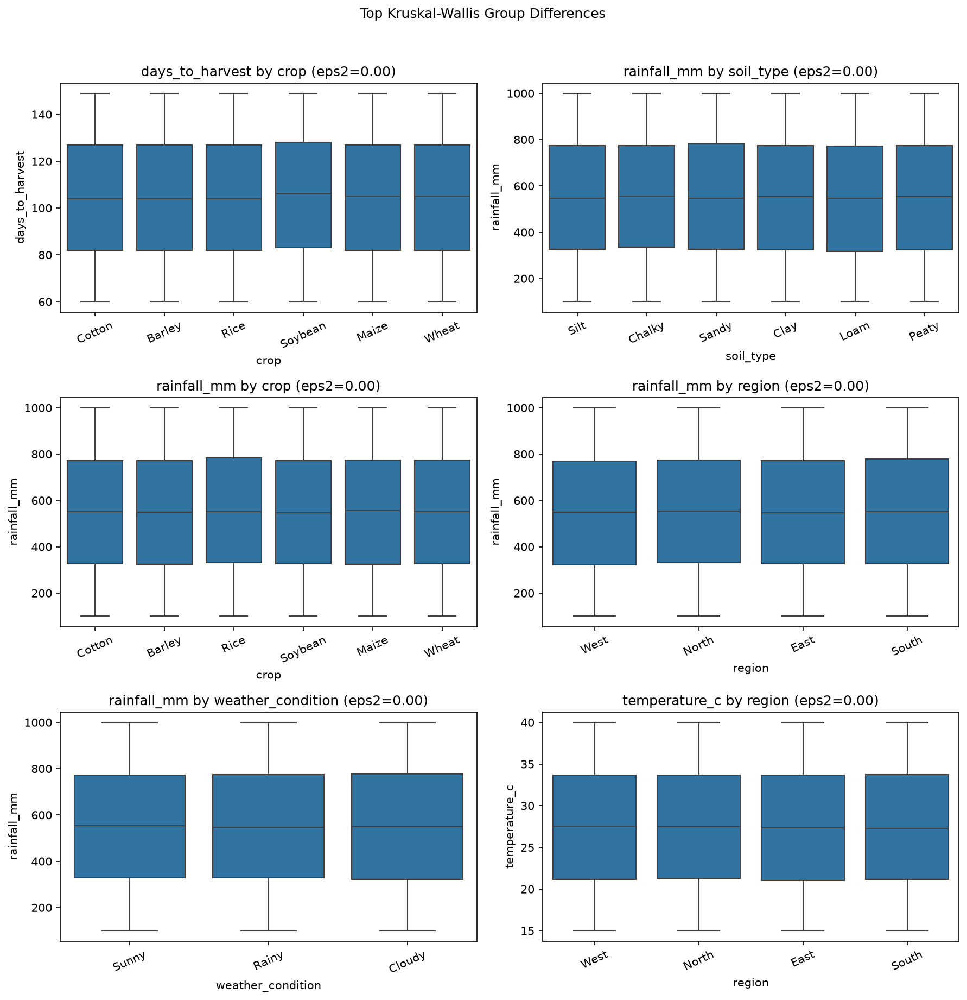

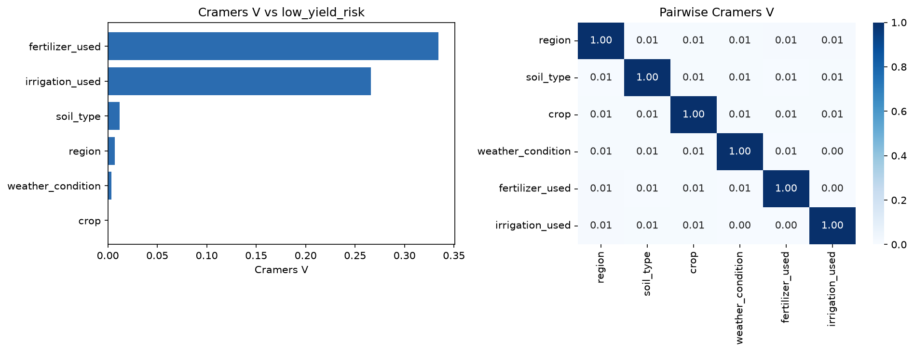

| numeric_col | categorical_col | h_stat | p_value | p_adj_fdr | epsilon_sq | n_groups | n_total |
| --- | --- | --- | --- | --- | --- | --- | --- |
| days_to_harvest | crop | 7.6601 | 0.1760 | 0.9083 | 0.0001 | 6 | 50000 |
| rainfall_mm | soil_type | 6.9233 | 0.2264 | 0.9083 | 0.0000 | 6 | 50000 |
| rainfall_mm | crop | 2.1342 | 0.8303 | 0.9083 | 0.0000 | 6 | 50000 |
| rainfall_mm | region | 2.8168 | 0.4207 | 0.9083 | 0.0000 | 4 | 50000 |
| rainfall_mm | weather_condition | 0.7406 | 0.6905 | 0.9083 | 0.0000 | 3 | 50000 |
| temperature_c | region | 1.6114 | 0.6568 | 0.9083 | 0.0000 | 4 | 50000 |
| temperature_c | crop | 4.5039 | 0.4794 | 0.9083 | 0.0000 | 6 | 50000 |
| temperature_c | soil_type | 4.9774 | 0.4186 | 0.9083 | 0.0000 | 6 | 50000 |
| temperature_c | weather_condition | 0.5494 | 0.7598 | 0.9083 | 0.0000 | 3 | 50000 |
| days_to_harvest | region | 0.5997 | 0.8965 | 0.9083 | 0.0000 | 4 | 50000 |
| days_to_harvest | soil_type | 3.6170 | 0.6058 | 0.9083 | 0.0000 | 6 | 50000 |
| days_to_harvest | weather_condition | 0.1923 | 0.9083 | 0.9083 | 0.0000 | 3 | 50000 |

| feature | cramers_v | p_value |
| --- | --- | --- |
| fertilizer_used | 0.3342 | 0.0000 |
| irrigation_used | 0.2661 | 0.0000 |
| soil_type | 0.0118 | 0.2252 |
| region | 0.0072 | 0.4651 |
| weather_condition | 0.0038 | 0.6927 |
| crop | 0.0001 | 1.0000 |

**What the output says:**
- `0` of `12` numeric-by-categorical Kruskal-Wallis pairs are significant after FDR correction (`q < 0.05`).
- Highest categorical/binary Cramer's V with target: `fertilizer_used` (`V = 0.334`).

---

## 3. Data Cleaning Audit

| step | issue | action | rows_affected |
| --- | --- | --- | --- |
| finalize_dtypes | Unoptimized or mixed column dtypes | Finalized dtypes across 10 columns and reset index | 50000 |

**What the output says:**
- **Row preservation:** `50,000` rows in -> `50,000` rows out.
- **Memory optimization:** `12.59 MB` -> `1.19 MB` (`90.5%` reduction via compact dtypes).

---

## 4. Leakage Sanity Check

| feature | abs_spearman | single_feature_auc | flagged | reason |
| --- | --- | --- | --- | --- |
| rainfall_mm | 0.6365 | 0.8852 | False | clean |
| fertilizer_used | 0.3342 | 0.6752 | False | clean |
| irrigation_used | 0.2662 | 0.6395 | False | clean |
| temperature_c | 0.0685 | 0.5415 | False | clean |
| soil_type | 0.0118 | 0.5024 | False | clean |
| days_to_harvest | 0.0026 | 0.5016 | False | clean |
| region | 0.0072 | 0.5007 | False | clean |
| weather_condition | 0.0038 | 0.4960 | False | clean |
| crop | 0.0001 | 0.4882 | False | clean |

**What the output says:**
- Zero columns exceeded the leakage threshold.

---

## 5. Feature Engineering & Model Validation

- **Engineered columns:** `binary_signal_sum, primary_driver_deficit, deficit_x_zero_signal, primary_x_binary_sum`
- **Raw signal columns:** `fertilizer_used, irrigation_used`
- **Inferred risk threshold:** `730.87` (`below`)

### 5.1 Engineered Feature Diagnostics & Target Correlations

| index | column | count | mean | std | median | iqr | min | max | skewness | kurtosis | outlier_count_iqr | outlier_pct |
| --- | --- | --- | --- | --- | --- | --- | --- | --- | --- | --- | --- | --- |
| 0 | binary_signal_sum | 50000 | 0.998 | 0.709 | 1.000 | 2.000 | 0.000 | 2.000 | 0.003 | -1.009 | 0 | 0.000 |
| 1 | primary_driver_deficit | 50000 | 220.448 | 209.736 | 180.585 | 404.947 | 0.000 | 630.860 | 0.428 | -1.247 | 0 | 0.000 |
| 2 | deficit_x_zero_signal | 50000 | 56.108 | 143.199 | 0.000 | 0.000 | 0.000 | 630.690 | 2.580 | 5.475 | 8802 | 17.604 |
| 3 | primary_x_binary_sum | 50000 | 550.731 | 504.937 | 481.215 | 839.223 | 0.000 | 1999.840 | 0.882 | 0.214 | 0 | 0.000 |

| feature | is_engineered | spearman_r | abs_spearman_r |
| --- | --- | --- | --- |
| primary_driver_deficit | True | 0.6417 | 0.6417 |
| rainfall_mm | False | -0.6365 | 0.6365 |
| primary_x_binary_sum | True | -0.6296 | 0.6296 |
| deficit_x_zero_signal | True | 0.5336 | 0.5336 |
| binary_signal_sum | True | -0.4235 | 0.4235 |
| fertilizer_used | False | -0.3342 | 0.3342 |
| irrigation_used | False | -0.2662 | 0.2662 |

### 5.2 Visual Check: Engineered Risk Curves

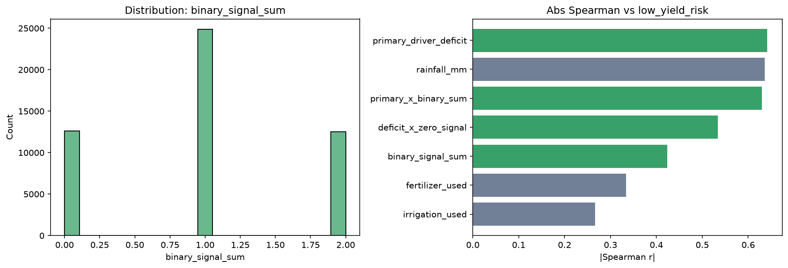

### 5.3 Cross-Validated ROC-AUC Comparison

| model_set | n_features | mean_auc | std_auc | min_auc | max_auc |
| --- | --- | --- | --- | --- | --- |
| raw_features | 9 | 0.9780 | 0.0005 | 0.9771 | 0.9787 |
| engineered_only | 4 | 0.9730 | 0.0004 | 0.9725 | 0.9736 |
| raw_plus_engineered | 13 | 0.9780 | 0.0005 | 0.9771 | 0.9786 |

**How to read the CV AUC table:**
- `raw_features` (`9` features): mean ROC-AUC `0.9780` (std `0.0005`, range `0.9771`–`0.9787`).
- `engineered_only` (`4` features): mean ROC-AUC `0.9730` (std `0.0004`, range `0.9725`–`0.9736`).
- `raw_plus_engineered` (`13` features): mean ROC-AUC `0.9780` (std `0.0005`, range `0.9771`–`0.9786`).

---

## 6. CLI Exit Codes & Reproducibility

| code | error_class | meaning |
| --- | --- | --- |
| 0 | EXIT_SUCCESS | Pipeline completed successfully |
| 2 | InvalidArgumentError | Invalid CLI or function argument |
| 3 | InputNotFoundError | Input file or directory not found |
| 4 | EmptyDataError | Input dataset is empty or has no remaining rows |
| 5 | MalformedDataError | Input file is malformed or unsupported |
| 6 | MissingColumnError | Required column is missing from dataset |
| 7 | AnalysisError | Statistical or modeling analysis failed |
| 8 | ReportWriteError | Failed to write output or create directory |
| 99 | EXIT_UNEXPECTED | Unexpected unhandled error |

Reproduce this report via:

```bash
python -m src.data report --input data/raw --output src/data --assets src/assets
```

---

## License

AgriPak is MIT-licensed, as found in the [LICENSE](../../LICENSE) file.
