

# AgriPak Data Analysis Report

**Dynamically generated exploratory audit, cleaning log, leakage check, and feature-engineering report.**

**[1. Overview](#1-dataset-overview--target-balance)** |
**[2. Statistical Audit](#2-data-quality--exploratory-statistical-audit)** |
**[3. Cleaning](#3-data-cleaning-audit)** |
**[4. Leakage Check](#4-leakage-sanity-check)** |
**[5. Feature Engineering](#5-feature-engineering--model-validation)** |
**[6. Exit Codes & Reproducibility](#6-cli-exit-codes--reproducibility)** |
**[Project README](../../README.md)**

---

This report is dynamically generated from `data/raw` and provides two high-level deliverables:

- Complete exploratory and statistical audit covering distributions, non-parametric tests, correlations, interactions, and independence checks.
- Reproducible cleaning audit, single-feature leakage verification, plot-driven feature engineering, and cross-validated model benchmarks.

| Metric | Value |
| --- | --- |
| Raw input shape | `50,000` rows x `10` cols |
| Cleaned shape | `50,000` rows x `10` cols |
| Memory footprint | `12.59 MB` -> `1.48 MB` |
| Inferred target | `fertilizer_used` (`49.9%` baseline) |
| Generated charts | `11` / `14` |

---

## 1. Dataset Overview & Target Balance

Source input: `data/raw`

- **Dimensions:** `50,000` rows x `10` columns (raw input `50,000` x `10`)
- **Minimum subgroup threshold (`min_n`):** `500`
- **Baseline positive rate:** `49.9%`
- **Target column:** `fertilizer_used` (`binary`)
- **Primary driver:** `low_yield_risk`
- **Secondary driver:** `temperature_c`
- **Primary subgroup:** `soil_type`

### 1.1 Schema & Column Profiles

| column | kind | role | dtype | nunique | null_count | null_pct |
| --- | --- | --- | --- | --- | --- | --- |
| region | categorical | feature | str | 4 | 0 | 0.00 |
| soil_type | categorical | subgroup | str | 6 | 0 | 0.00 |
| crop | categorical | feature | str | 6 | 0 | 0.00 |
| rainfall_mm | numeric_continuous | feature | float64 | 38405 | 0 | 0.00 |
| temperature_c | numeric_continuous | feature | float64 | 2501 | 0 | 0.00 |
| fertilizer_used | binary | target | int64 | 2 | 0 | 0.00 |
| irrigation_used | binary | feature | int64 | 2 | 0 | 0.00 |
| weather_condition | categorical | feature | str | 3 | 0 | 0.00 |
| days_to_harvest | numeric_continuous | feature | int64 | 90 | 0 | 0.00 |
| low_yield_risk | binary | feature | int64 | 2 | 0 | 0.00 |

### 1.2 Numeric Summary & Target Distribution

| index | count | mean | std | min | 25% | 50% | 75% | max |
| --- | --- | --- | --- | --- | --- | --- | --- | --- |
| rainfall_mm | 50000.000 | 550.873 | 259.775 | 100.010 | 325.923 | 550.285 | 774.422 | 999.980 |
| temperature_c | 50000.000 | 27.428 | 7.232 | 15.000 | 21.150 | 27.420 | 33.670 | 40.000 |
| days_to_harvest | 50000.000 | 104.606 | 25.891 | 60.000 | 82.000 | 105.000 | 127.000 | 149.000 |

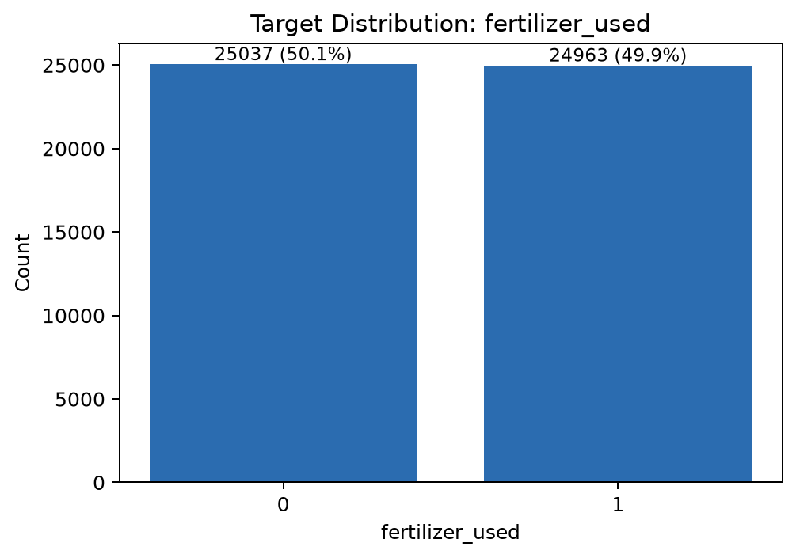

**What the output says:**
- `fertilizer_used` has `49.9%` positive class and `50.1%` negative class across `50,000` rows.
- Raw dataset memory footprint before optimization: `1.48 MB`.

---

## 2. Data Quality & Exploratory Statistical Audit

### 2.1 Nulls, Cardinality, Exact Duplicates & Text Hygiene

| column | dtype | non_null | missing_count | missing_pct | n_unique |
| --- | --- | --- | --- | --- | --- |
| region | category | 50000 | 0 | 0.000 | 4 |
| soil_type | category | 50000 | 0 | 0.000 | 6 |
| crop | category | 50000 | 0 | 0.000 | 6 |
| rainfall_mm | float64 | 50000 | 0 | 0.000 | 38405 |
| temperature_c | float64 | 50000 | 0 | 0.000 | 2501 |
| fertilizer_used | int8 | 50000 | 0 | 0.000 | 2 |
| irrigation_used | int8 | 50000 | 0 | 0.000 | 2 |
| weather_condition | category | 50000 | 0 | 0.000 | 3 |
| days_to_harvest | float64 | 50000 | 0 | 0.000 | 90 |
| low_yield_risk | int8 | 50000 | 0 | 0.000 | 2 |

| column | whitespace_issues | missing_token_hits | case_variants |
| --- | --- | --- | --- |
| region | 0 | 0 | 0 |
| soil_type | 0 | 0 | 0 |
| crop | 0 | 0 | 0 |
| weather_condition | 0 | 0 | 0 |

**What the output says:**
- **Completeness:** `0` missing values across `10` columns and `0` exact duplicate rows.
- **Text hygiene:** `0` leading/trailing whitespace issues, `0` placeholder tokens, and `0` case-variant collisions.

### 2.2 Numeric Distributions & Shape Metrics

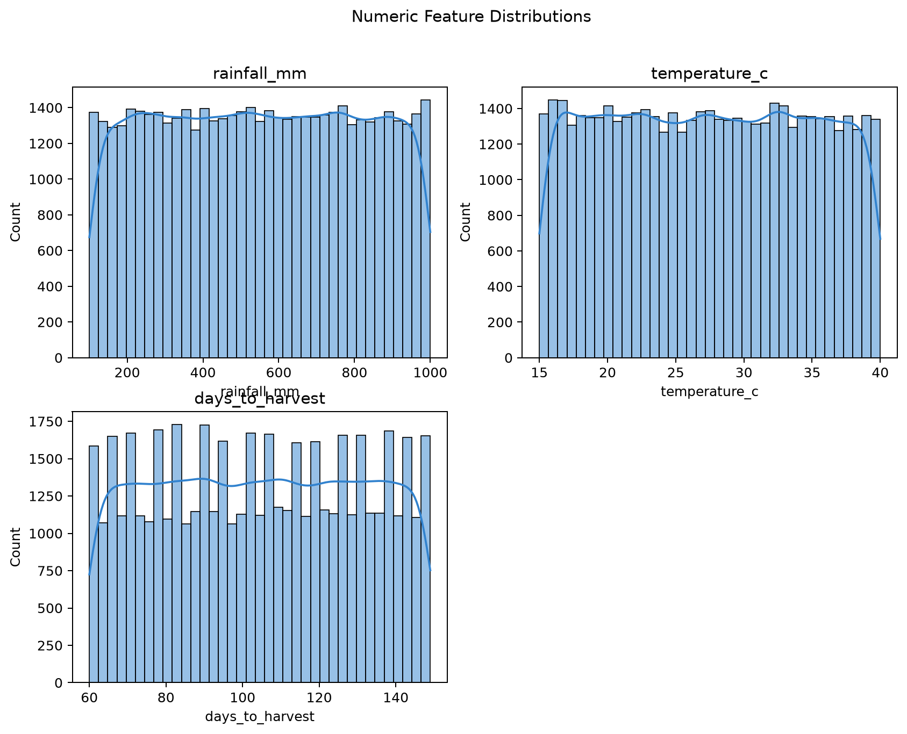

| column | count | mean | std | median | iqr | min | max | skewness | kurtosis | outlier_count_iqr | outlier_pct |
| --- | --- | --- | --- | --- | --- | --- | --- | --- | --- | --- | --- |
| rainfall_mm | 50000 | 550.873 | 259.775 | 550.285 | 448.500 | 100.010 | 999.980 | -0.000 | -1.196 | 0 | 0.000 |
| temperature_c | 50000 | 27.428 | 7.232 | 27.420 | 12.520 | 15.000 | 40.000 | 0.007 | -1.205 | 0 | 0.000 |
| days_to_harvest | 50000 | 104.606 | 25.891 | 105.000 | 45.000 | 60.000 | 149.000 | -0.001 | -1.197 | 0 | 0.000 |

**What the output says:**
- `rainfall_mm` spans `100.01` to `999.98` (median `550.28`, skew `-0.000`, excess kurtosis `-1.196`).
- `temperature_c` spans `15.00` to `40.00` (median `27.42`, skew `0.007`, excess kurtosis `-1.205`).
- `days_to_harvest` spans `60.00` to `149.00` (median `105.00`, skew `-0.001`, excess kurtosis `-1.197`).

### 2.3 Categorical & Binary Feature Distributions

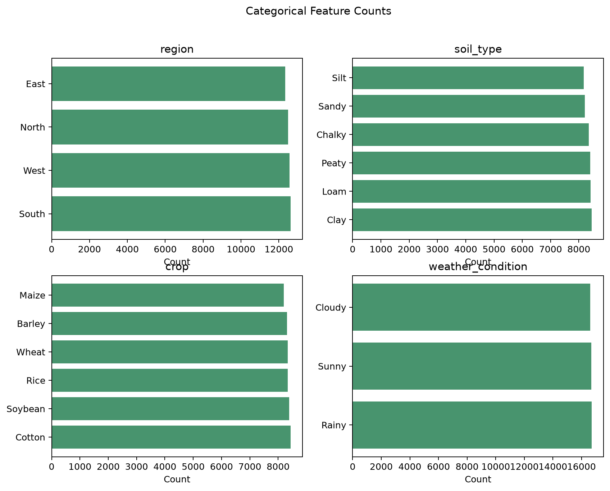

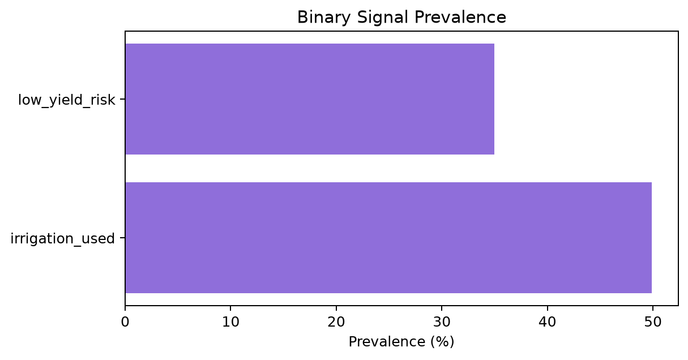

**What the output says:**
- `region` has `4` levels; level shares range from `24.7%` to `25.2%` (largest: `South` at `25.2%`).
- `soil_type` has `6` levels; level shares range from `16.3%` to `16.9%` (largest: `Clay` at `16.9%`).
- `crop` has `6` levels; level shares range from `16.4%` to `16.9%` (largest: `Cotton` at `16.9%`).
- `weather_condition` has `3` levels; level shares range from `33.2%` to `33.4%` (largest: `Rainy` at `33.4%`).
- `fertilizer_used` has `2` levels; level shares range from `49.9%` to `50.1%` (largest: `0` at `50.1%`).
- `irrigation_used` has `2` levels; level shares range from `49.9%` to `50.1%` (largest: `0` at `50.1%`).
- `low_yield_risk` has `2` levels; level shares range from `35.0%` to `65.0%` (largest: `0` at `65.0%`).

### 2.4 Target Rate by Categorical & Binary Features

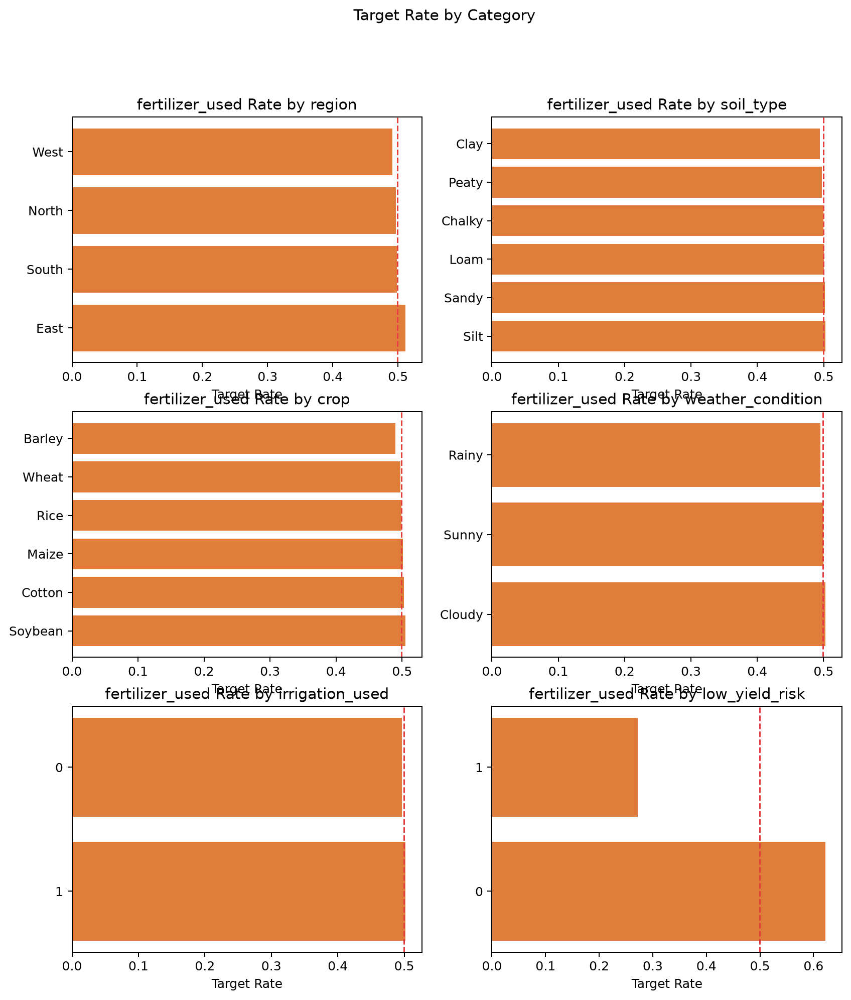

**What the output says:**
- `region` target rate spans `49.1%` (`West`) to `51.1%` (`East`), spread `2.0` pp.
- `soil_type` target rate spans `49.4%` (`Clay`) to `50.2%` (`Silt`), spread `0.8` pp.
- `crop` target rate spans `49.0%` (`Barley`) to `50.5%` (`Soybean`), spread `1.5` pp.
- `weather_condition` target rate spans `49.5%` (`Rainy`) to `50.3%` (`Cloudy`), spread `0.7` pp.
- `irrigation_used` target rate spans `49.7%` (`0`) to `50.2%` (`1`), spread `0.5` pp.
- `low_yield_risk` target rate spans `27.2%` (`1`) to `62.2%` (`0`), spread `35.0` pp.

### 2.5 Numeric Distributions by Target Class & Mann-Whitney U Tests

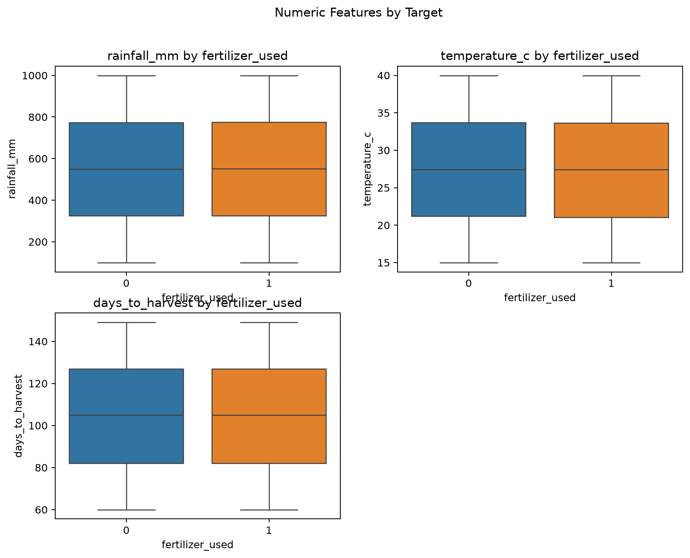

| feature | u_stat | p_value | p_adj_fdr | median_neg | median_pos | rank_biserial |
| --- | --- | --- | --- | --- | --- | --- |
| low_yield_risk | 212873065.5000 | 0.0000 | 0.0000 | 1.0000 | 0.0000 | -0.3188 |
| temperature_c | 310693223.0000 | 0.2631 | 0.4791 | 27.4300 | 27.4100 | -0.0058 |
| irrigation_used | 313985816.5000 | 0.2875 | 0.4791 | 0.0000 | 1.0000 | 0.0048 |
| days_to_harvest | 311469502.5000 | 0.5234 | 0.6542 | 105.0000 | 105.0000 | -0.0033 |
| rainfall_mm | 312471203.5000 | 0.9861 | 0.9861 | 549.6100 | 550.7700 | -0.0001 |

**What the output says:**
- `low_yield_risk`: median `1.00` (class 0) vs `0.00` (class 1), rank-biserial `-0.319`, FDR q-value `0.000e+00`.
- `temperature_c`: median `27.43` (class 0) vs `27.41` (class 1), rank-biserial `-0.006`, FDR q-value `4.791e-01`.
- `irrigation_used`: median `0.00` (class 0) vs `1.00` (class 1), rank-biserial `0.005`, FDR q-value `4.791e-01`.
- `days_to_harvest`: median `105.00` (class 0) vs `105.00` (class 1), rank-biserial `-0.003`, FDR q-value `6.542e-01`.
- `rainfall_mm`: median `549.61` (class 0) vs `550.77` (class 1), rank-biserial `-0.000`, FDR q-value `9.861e-01`.

### 2.6 Spearman Correlation & Decile Target Curves

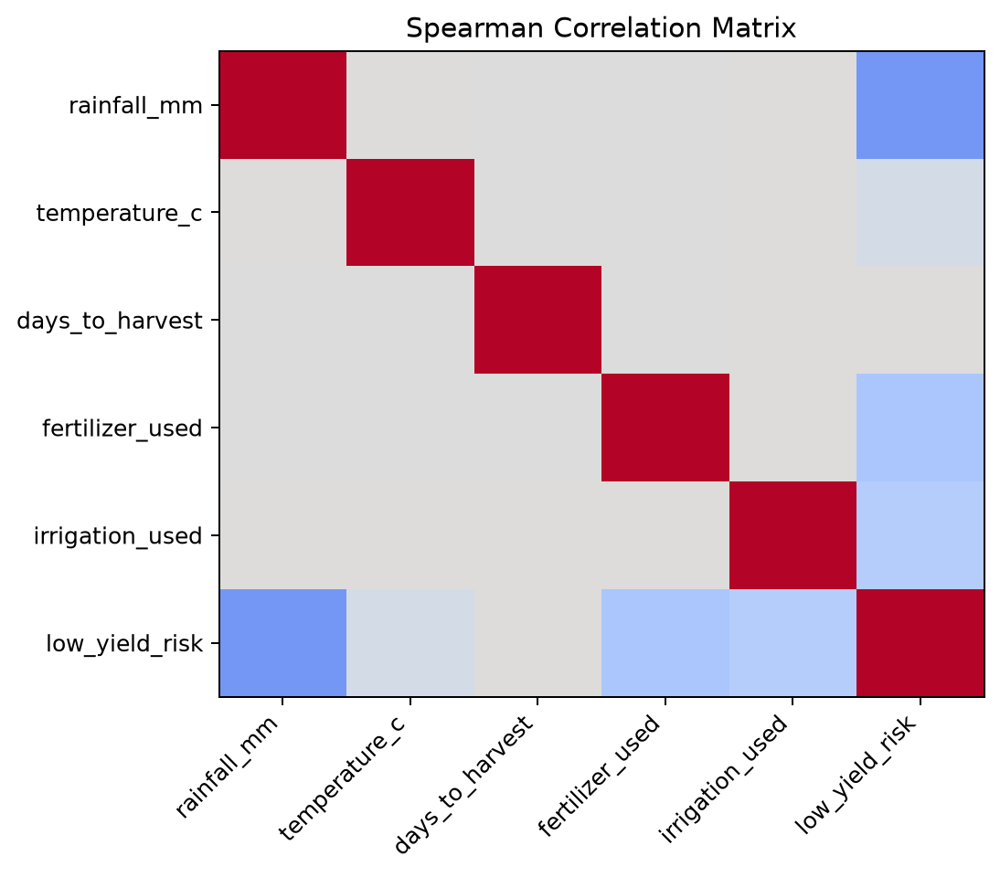

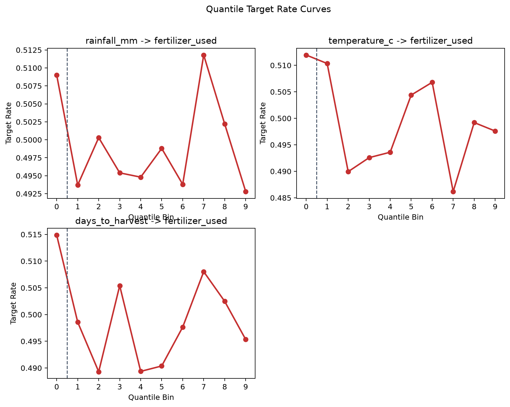

| feature | spearman_r | abs_spearman_r |
| --- | --- | --- |
| low_yield_risk | -0.3342 | 0.3342 |
| temperature_c | -0.0050 | 0.0050 |
| irrigation_used | 0.0048 | 0.0048 |
| days_to_harvest | -0.0029 | 0.0029 |
| rainfall_mm | -0.0001 | 0.0001 |

**What the output says:**
- Strongest monotonic predictor of target is `low_yield_risk` (Spearman `rho = -0.334`).
- `rainfall_mm` decile target rate ranges from `49.3%` to `51.2%`.
- `temperature_c` decile target rate ranges from `48.6%` to `51.2%`.
- `days_to_harvest` decile target rate ranges from `48.9%` to `51.5%`.

### 2.7 Pairwise Interactions & Condition Combinations

> **pairwise_risk_heatmaps** skipped: plot failed: too many values to unpack (expected 2).

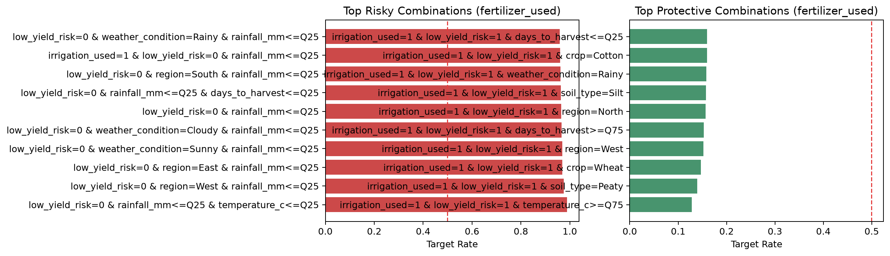

Evaluated `2,326` multi-feature combinations with `n >= 500`.

#### Top Elevated-Risk Combinations

| combination | k | n | target_rate | lift | synergy |
| --- | --- | --- | --- | --- | --- |
| low_yield_risk=0 & rainfall_mm<=Q25 & temperature_c<=Q25 | 3 | 512 | 0.988 | 0.489 | 0.358 |
| low_yield_risk=0 & region=West & rainfall_mm<=Q25 | 3 | 696 | 0.976 | 0.476 | 0.362 |
| low_yield_risk=0 & region=East & rainfall_mm<=Q25 | 3 | 661 | 0.970 | 0.470 | 0.336 |
| low_yield_risk=0 & weather_condition=Sunny & rainfall_mm<=Q25 | 3 | 873 | 0.969 | 0.470 | 0.347 |
| low_yield_risk=0 & weather_condition=Cloudy & rainfall_mm<=Q25 | 3 | 876 | 0.966 | 0.466 | 0.341 |
| low_yield_risk=0 & rainfall_mm<=Q25 | 2 | 2612 | 0.965 | 0.466 | 0.343 |
| low_yield_risk=0 & rainfall_mm<=Q25 & days_to_harvest<=Q25 | 3 | 632 | 0.964 | 0.464 | 0.339 |
| low_yield_risk=0 & region=South & rainfall_mm<=Q25 | 3 | 634 | 0.962 | 0.463 | 0.342 |
| irrigation_used=1 & low_yield_risk=0 & rainfall_mm<=Q25 | 3 | 2320 | 0.960 | 0.461 | 0.336 |
| low_yield_risk=0 & weather_condition=Rainy & rainfall_mm<=Q25 | 3 | 863 | 0.959 | 0.460 | 0.341 |

#### Top Protective Combinations

| combination | k | n | target_rate | lift | synergy |
| --- | --- | --- | --- | --- | --- |
| irrigation_used=1 & low_yield_risk=1 & temperature_c>=Q75 | 3 | 1162 | 0.128 | -0.371 | -0.143 |
| irrigation_used=1 & low_yield_risk=1 & soil_type=Peaty | 3 | 932 | 0.139 | -0.360 | -0.133 |
| irrigation_used=1 & low_yield_risk=1 & crop=Wheat | 3 | 948 | 0.147 | -0.353 | -0.125 |
| irrigation_used=1 & low_yield_risk=1 & region=West | 3 | 1429 | 0.152 | -0.347 | -0.114 |
| irrigation_used=1 & low_yield_risk=1 & days_to_harvest>=Q75 | 3 | 1419 | 0.153 | -0.346 | -0.121 |
| irrigation_used=1 & low_yield_risk=1 & region=North | 3 | 1452 | 0.156 | -0.343 | -0.115 |
| irrigation_used=1 & low_yield_risk=1 & soil_type=Silt | 3 | 891 | 0.157 | -0.342 | -0.120 |
| irrigation_used=1 & low_yield_risk=1 & weather_condition=Rainy | 3 | 1814 | 0.158 | -0.341 | -0.112 |
| irrigation_used=1 & low_yield_risk=1 & crop=Cotton | 3 | 945 | 0.160 | -0.339 | -0.118 |
| irrigation_used=1 & low_yield_risk=1 & days_to_harvest<=Q25 | 3 | 1414 | 0.160 | -0.339 | -0.117 |

#### Strongest Non-Additive Synergies

| combination | k | n | target_rate | lift | synergy |
| --- | --- | --- | --- | --- | --- |
| low_yield_risk=0 & region=West & rainfall_mm<=Q25 | 3 | 696 | 0.976 | 0.476 | 0.362 |
| low_yield_risk=0 & rainfall_mm<=Q25 & temperature_c<=Q25 | 3 | 512 | 0.988 | 0.489 | 0.358 |
| low_yield_risk=0 & weather_condition=Sunny & rainfall_mm<=Q25 | 3 | 873 | 0.969 | 0.470 | 0.347 |
| low_yield_risk=0 & rainfall_mm<=Q25 | 2 | 2612 | 0.965 | 0.466 | 0.343 |
| low_yield_risk=0 & region=South & rainfall_mm<=Q25 | 3 | 634 | 0.962 | 0.463 | 0.342 |
| low_yield_risk=0 & weather_condition=Rainy & rainfall_mm<=Q25 | 3 | 863 | 0.959 | 0.460 | 0.341 |
| low_yield_risk=0 & weather_condition=Cloudy & rainfall_mm<=Q25 | 3 | 876 | 0.966 | 0.466 | 0.341 |
| low_yield_risk=0 & rainfall_mm<=Q25 & days_to_harvest<=Q25 | 3 | 632 | 0.964 | 0.464 | 0.339 |
| low_yield_risk=0 & rainfall_mm<=Q25 & days_to_harvest>=Q75 | 3 | 682 | 0.959 | 0.460 | 0.337 |
| irrigation_used=1 & low_yield_risk=0 & rainfall_mm<=Q25 | 3 | 2320 | 0.960 | 0.461 | 0.336 |

**What the output says:**
- Train/test split replication rate across top combinations: `100.0%`.

### 2.8 Continuous x Binary Interactions & Subgroup Stability

> **continuous_binary_interactions** skipped: plot failed: too many values to unpack (expected 2).

> **subgroup_risk_surfaces** skipped: plot failed: not enough values to unpack (expected 2, got 0).

**What the output says:**
- Primary continuous driver `low_yield_risk` paired with secondary driver `temperature_c` across subgroup `soil_type`.
- Computed subgroup risk surfaces across `6` subgroup levels (each cell filtered by `n >= 500`).

### 2.9 Kruskal-Wallis Group Tests & Cramer's V Associations

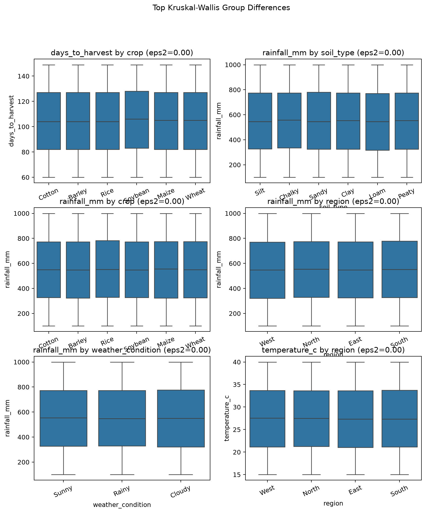

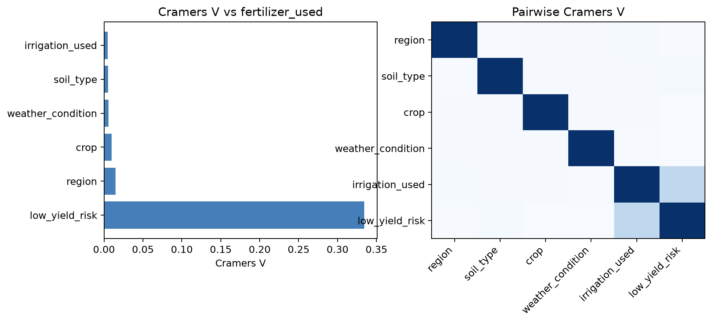

| numeric_col | categorical_col | h_stat | p_value | p_adj_fdr | epsilon_sq | n_groups | n_total |
| --- | --- | --- | --- | --- | --- | --- | --- |
| days_to_harvest | crop | 7.6601 | 0.1760 | 0.9083 | 0.0001 | 6 | 50000 |
| rainfall_mm | soil_type | 6.9233 | 0.2264 | 0.9083 | 0.0000 | 6 | 50000 |
| rainfall_mm | crop | 2.1342 | 0.8303 | 0.9083 | 0.0000 | 6 | 50000 |
| rainfall_mm | region | 2.8168 | 0.4207 | 0.9083 | 0.0000 | 4 | 50000 |
| rainfall_mm | weather_condition | 0.7406 | 0.6905 | 0.9083 | 0.0000 | 3 | 50000 |
| temperature_c | region | 1.6114 | 0.6568 | 0.9083 | 0.0000 | 4 | 50000 |
| temperature_c | crop | 4.5039 | 0.4794 | 0.9083 | 0.0000 | 6 | 50000 |
| temperature_c | soil_type | 4.9774 | 0.4186 | 0.9083 | 0.0000 | 6 | 50000 |
| temperature_c | weather_condition | 0.5494 | 0.7598 | 0.9083 | 0.0000 | 3 | 50000 |
| days_to_harvest | region | 0.5997 | 0.8965 | 0.9083 | 0.0000 | 4 | 50000 |
| days_to_harvest | soil_type | 3.6170 | 0.6058 | 0.9083 | 0.0000 | 6 | 50000 |
| days_to_harvest | weather_condition | 0.1923 | 0.9083 | 0.9083 | 0.0000 | 3 | 50000 |

| feature | cramers_v | p_value |
| --- | --- | --- |
| low_yield_risk | 0.3342 | 0.0000 |
| region | 0.0147 | 0.0130 |
| crop | 0.0096 | 0.4624 |
| weather_condition | 0.0059 | 0.4212 |
| soil_type | 0.0055 | 0.9100 |
| irrigation_used | 0.0047 | 0.2916 |

**What the output says:**
- `0` of `12` numeric-by-categorical Kruskal-Wallis pairs are significant after FDR correction (`q < 0.05`).
- Highest categorical/binary Cramer's V with target: `low_yield_risk` (`V = 0.334`).

---

## 3. Data Cleaning Audit

| step | issue | action | rows_affected |
| --- | --- | --- | --- |
| finalize_dtypes | Unoptimized or mixed column dtypes | Finalized dtypes across 10 columns and reset index | 50000 |

**What the output says:**
- **Row preservation:** `50,000` rows in -> `50,000` rows out.
- **Memory optimization:** `12.59 MB` -> `1.48 MB` (`88.2%` reduction via compact dtypes).

---

## 4. Leakage Sanity Check

| feature | metric | score | flagged |
| --- | --- | --- | --- |
| low_yield_risk | roc_auc | 0.6594 | False |
| temperature_c | roc_auc | 0.5029 | False |
| irrigation_used | roc_auc | 0.5024 | False |
| days_to_harvest | roc_auc | 0.5016 | False |
| rainfall_mm | roc_auc | 0.5000 | False |
| region | cramers_v | 0.0147 | False |
| crop | cramers_v | 0.0096 | False |
| weather_condition | cramers_v | 0.0059 | False |
| soil_type | cramers_v | 0.0055 | False |

**What the output says:**
- Zero columns exceeded the leakage threshold.
- Zero exact duplicate rows detected.
- High split-half combination replication (100.0%).
